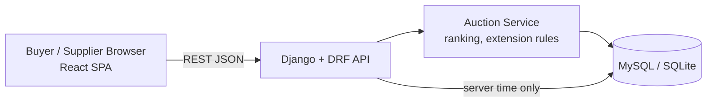

# British Auction RFQ System: HLD & Schema

## Architecture


**Components**
- **React SPA**: listing page, details page (bids, ranks, config, activity log), RFQ create form, quote submit form.
- **Django REST API**: validates input, delegates to the service layer.
- **Auction Service** (`services.py`): the only place that places bids and extends time.
- **Database**: source of truth. Row lock on the RFQ serializes concurrent bids.

**Bid flow (POST /api/rfqs/{id}/bids/)**
1. Open `transaction.atomic()` and `select_for_update()` the RFQ row.
2. Reject if `now < start` or `now >= close_time` (auction over).
3. Compute ranking BEFORE, insert bid, compute ranking AFTER.
4. If `now` is within `[close - X, close)` and the trigger matches (any bid / rank change / L1 change): `new_close = min(close + Y, forced_close)`.
5. Write activity log rows (BID, EXTENSION with reason) and commit.

**Key decisions**
- *Status is computed on read* (no cron): `now < start` is Upcoming; `now >= close` is Force Closed if `close >= forced_close`, else Closed; otherwise Active.
- *Server time only.* Client time is never trusted.
- *Concurrency:* `SELECT ... FOR UPDATE` on the RFQ row, so two bids are processed one at a time.
- *Ranking:* each supplier is ranked by their best (lowest) total; ties go to the earlier bid.
- A supplier's new bid must be lower than their own previous best (suppliers "lower their prices").

## Schema
```sql
supplier(id PK, name UNIQUE)

rfq(id PK, reference_id UNIQUE, name,
    bid_start DATETIME, original_close DATETIME,
    bid_close DATETIME,           -- current, may be extended
    forced_close DATETIME,        -- CHECK forced_close > original_close
    pickup_date DATE,
    trigger_window_min INT,       -- X
    extension_min INT,            -- Y
    trigger_type ENUM('ANY_BID','ANY_RANK_CHANGE','L1_CHANGE'),
    created_at)

bid(id PK, rfq_id FK, supplier_id FK, carrier_name,
    freight DECIMAL, origin_charges DECIMAL, destination_charges DECIMAL,
    total DECIMAL, transit_days INT, validity_days INT,
    created_at,
    INDEX(rfq_id, total), INDEX(rfq_id, supplier_id))

activity_log(id PK, rfq_id FK, event_type ENUM('BID','EXTENSION','CLOSED'),
    message, old_close NULL, new_close NULL, created_at,
    INDEX(rfq_id, created_at))
```
Relations: rfq 1-N bid, supplier 1-N bid, rfq 1-N activity_log.